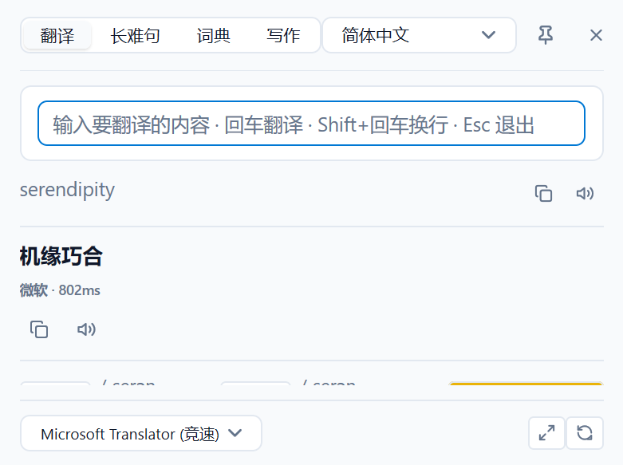
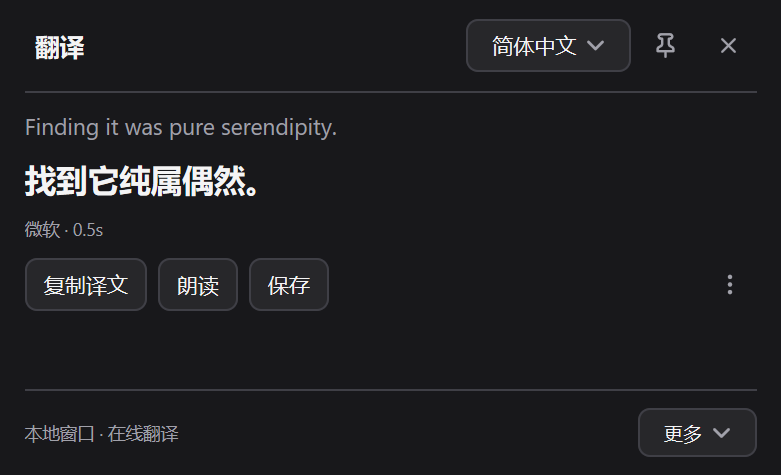

# fast词典 (fastDictionary)

<p align="center">
  <strong>极速响应、原生轻量的 Windows 桌面划词翻译与学习伴读工具</strong>
</p>

<p align="center">
  
  
  
  
</p>

---

## 🌟 为什么选择 fast词典？

在桌面阅读与学习英语时，许多现代翻译工具要么依赖笨重的 Electron / WebView 框架（内存占用数百兆、唤醒延迟明显），要么充斥着高饱和渐变与卡片堆砌的视觉噪音。

**fast词典 (fastDictionary)** 秉持三项核心原则打造：
1. **Native Precision（原生精准）**：纯 Go 开发（基于 [mygo](https://github.com/egoist/mygo) 原生渲染），无 cgo、无重量级浏览器内核。二进制体积约 22MB，划词唤醒延迟低于 50ms，内存消耗极低。
2. **Quiet Craft（克制考究）**：拒绝粗劣套壳与视觉噪音。悬浮条采用硬件级区域裁切（`CombineRgn`），0 杂色 0 黑边；冷调低饱和配色系统，悬停即时提示操作释义。
3. **Learner First（学习者优先）**：不仅仅是查一个中文释义，更提供 CEFR 难度分级、标准 IPA 音标、长难句语法树拆解、AI 写作润色对比与生词本管理。

---

## 📸 界面预览

| 悬浮胶囊工具条 (Selection Chip) | 悬停即显功能释义 (Flyout Tip) |
| :---: | :---: |
|  |  |

| 学习者词典 (IPA 音标 / CEFR 分级 / 语境例句) | 长难句语法拆解 (主谓宾 / 从句高亮) |
| :---: | :---: |
|  |  |

| 英文写作改进与润色 (Diff 对比) | 划词翻译面板 (多引擎聚合) |
| :---: | :---: |
|  |  |

<p align="center">
  <strong>深浅色模式与原生设置面板</strong><br/>
  
</p>

---

## ✨ 核心特性

### 1. ⚡ 原生划词悬浮胶囊 (Selection Chip)
- 鼠标在任意应用中选中文本后，即刻就近呼出冷调胶囊工具条。
- **色彩克制**：仅主要操作带冷钢蓝强调色，次要按钮共用低饱和冷灰墨色，避免眼花缭乱。
- **悬停气泡提示**：鼠标移入任一按钮 160ms 即在正上方浮现功能气泡（`WS_POPUP`），移动时顺畅跟随无等待。
- 一键直达：划词翻译、真人发音朗读、查词典、长难句分析、写作润色或复制搜索。

### 2. 📘 学习者深度词典 (Learner's Dictionary)
- 自动解析并展示权威 **IPA 国际音标**，支持一键真人朗读发音。
- **CEFR 欧标难度分级**（A1/A2 翡翠绿、B1/B2 皇家蓝、C1/C2 典雅紫徽章），词汇难易一目了然。
- 提炼双语例句、句中词形还原与**词根/词源助记技巧 (Memory Tips)**。
- 支持一键收录至内置生词本。

### 3. 🔍 长难句深度语法分析 (Grammar Tutor)
- 智能拆解复杂长难句的句子结构：**主语 (Subject)**、**谓语 (Predicate)**、**宾语 (Object)**、**定语**、**状语**、**同位语**等语法成分彩色标注。
- 智能识别各级从句类型（时间状从、地点状从、原因状从、条件状从、定语从句等）。
- 语法主干提取与局部标记放大查看，真正辅助攻克学术文献与复杂长句。

### 4. ✏️ 英文写作改进与批注 (Writing Improvement)
- 结构化对比输入原文与润色建议。
- 逐项呈现修改批注（语法纠错、用词替换、语气地道化、表达精炼等），并说明修改理由。

### 5. 🌐 多引擎聚合与 AI 翻译 (Multi-Engine & AI)
- 聚合多种翻译服务：**DeepL**、**Google 翻译**、**腾讯翻译君**以及 **OpenAI / Claude / 自定义兼容的大模型 API**。
- 支持流式实时打字机回显，响应敏捷流畅。
- 支持 AI 精翻（Refine）进一步提升译文质感。

### 6. 📷 本地高精 Indra OCR 截图识字
- 搭载本地轻量离线 **Indra OCR** 引擎（基于 `onnxruntime_purego` 纯 Go 接口），内置 31MB 轻量高精度模型。
- 毫秒级快速推理，纯本地离线运行，无需外网或云端 API。
- 自带英文常见 OCR 错误自动校正（OCR Spell Correct）。
- 截图翻译支持 AI 精翻：先发送本地 OCR 文字，失败时自动附带原截图校正识别错误。
- 支持在未部署模型时自动回落至系统原生的 `Windows.Media.Ocr`。

### 7. 📚 生词本与复习管理 (Vocabulary Store)
- 生词分类整理：生词、长难句、写作改进条目分别归档。
- **间隔重复复习**：每个词记录到期时间与当前间隔。新保存的词立即进入队列，复习卡片先显示单词，再翻开释义、例句与记忆技巧。
- 三档反馈：忘记（10 分钟后回来）、模糊（间隔小幅延长）、记得（间隔翻倍，上限 180 天）。生词本页与托盘菜单都会显示到期数量。
- 支持富文本卡片查看与原声发音朗读。
- 支持全量 **JSON** 与 **Excel CSV** 格式双向导入导出，方便与 Anki、欧陆词典等工具联动背词。

---

## ⌨️ 默认快捷键

| 快捷键 | 功能 | 说明 |
| :--- | :--- | :--- |
| `Alt + D` | **划词翻译** | 选中文本后呼出主面板，或直接在光标处查词 |
| `Alt + Q` | **输入查词/翻译** | 快速弹出空输入框，随时键入中英文查询 |
| `Alt + C` | **截图识字翻译** | 框选屏幕任意区域进行 OCR 识别并翻译 |

> 快捷键可在设置界面自定义修改，热键冲突时支持优雅处理。

---

## 🛠️ 本地构建与运行

### 运行环境要求
- **操作系统**：Windows 10 / 11 (x64)
- **编译工具**：Go 1.27.3+
- **构建环境**：PowerShell 5.1+

### 构建步骤

```powershell
# 克隆仓库
git clone https://github.com/thegreatjx/fastDictionary.git
cd fastDictionary

# 拉取并校验 OCR 运行时（onnxruntime.dll + indra-models，固定版本 + SHA256）
# 不跑这一步也能编译，但截图识别会回落到 Windows OCR
.\scripts\fetch-ocr-deps.ps1

# 编译正式版（无控制台黑窗口，生成 fastDictionary.exe）
.\build.ps1

# 编译开发调试版（保留控制台日志输出，生成 fastDictionary-dev.exe）
.\build.ps1 -Dev

# 出包：dist 下的绿色目录、zip 与 SHA256
# 加 -Sign 并用 FD_SIGN_CERT / FD_SIGN_PASSWORD 指定证书时自动签名
.\build.ps1 -Package

# 启动界面场景预览（供微调排版与动效）
.\dev.ps1 -Scene grammar
```

> **依赖校验**：`build.ps1 -Package` 会按 `scripts/ocr-deps.json` 校验模型和 DLL；缺失或哈希不符时直接失败，避免发出没有本地 OCR 的包。

> **命名约定说明**：正式产物名称必须固定为 `fastDictionary.exe`。底层引擎根据可执行文件名称自动推导用户配置与词库目录（`%APPDATA%\fastDictionary\`），并维护单实例互斥锁。

---

## 📂 数据与存储路径

数据均存放于用户标准 AppData 目录下，绿色纯净，卸载或迁移只需备份该目录：

```text
%APPDATA%\fastDictionary\
├── config.json          # 用户全局偏好设置与加密后的 API Key
├── vocabulary.json      # 生词本、长难句与写作条目（含复习计划）
├── logs\                # 运行日志（fastDictionary.log；启动时超过 2 MB 轮转为 .1）
└── notebook.html        # 「网页版」生词本导出
```

日志默认只记录字符数，不记录选中的原文与 OCR 结果；排查取词问题可在
「设置 → 关于 → 诊断日志」临时打开，也可以在那里打开日志目录。

---

## 📑 深入文档

项目内部设计与测试基准细节请参阅 `docs/` 目录：

- [docs/README.md](docs/README.md) — 完整文档索引
- [CHANGELOG.md](CHANGELOG.md) — 版本更新记录
- [NOTICE](NOTICE) — 第三方组件与模型许可证
- [docs/DESIGN.md](docs/DESIGN.md) — 视觉系统与微交互设计原则
- [docs/HANDOFF_INDRA.md](docs/HANDOFF_INDRA.md) — Indra OCR 算法适配与本地推理落地方案
- [docs/ocr.md](docs/ocr.md) — 各大 OCR 方案性能与识别率实测数据对比

---

## 📄 开源许可证

本项目基于 [MIT License](LICENSE) 开源。随包分发的 ONNX Runtime 与 Indra OCR
模型另有许可证（模型为 OpenRAIL），详见 [NOTICE](NOTICE)。
