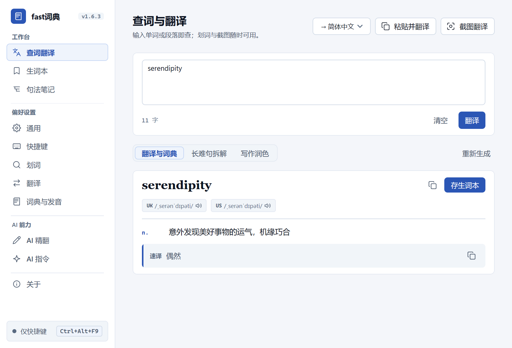

<h1 align="center">fast词典 <sub>fastDictionary</sub></h1>

<p align="center"><strong>原生划词翻译 × 英语学习工作台</strong></p>

<p align="center">
选中即译，查词即学。词典、长难句语法、写作润色、本地 OCR、生词本与 AI 精翻，<br/>
收在一个不依赖 WebView 的 Windows 原生应用里。
</p>

<p align="center">
  <a href="https://github.com/thegreatjx/fastDictionary/releases/latest"></a>
  
  
  
  
  
</p>

<p align="center">
  <a href="https://github.com/thegreatjx/fastDictionary/releases/latest"><strong>下载最新绿色版</strong></a>
  ·
  <a href="#界面预览">界面预览</a>
  ·
  <a href="#核心能力">核心能力</a>
  ·
  <a href="#快捷键">快捷键</a>
  ·
  <a href="#本地构建">本地构建</a>
</p>

---



## 下载

[**前往 Releases 下载最新版 →**](https://github.com/thegreatjx/fastDictionary/releases/latest)

- **绿色版**：`fastDictionary-vYYYY.MM.DD-win64.zip`，解压后双击 `fastDictionary.exe`，无需安装。
- **校验文件**：同名的 `.sha256` 文件，用来确认下载完整。
- 不写注册表、不提供 `setup.exe`；删除解压目录即可卸载。
- Release 页面底部的 **Assets** 区域才是可执行程序；`Source code (zip/tar.gz)` 是源码，不是安装包。

> Windows SmartScreen 可能对未签名的新版本给出提示，选择「更多信息 → 仍要运行」即可。项目暂未购买代码签名证书。

## 当前状态

| 项目 | 现状 |
| --- | --- |
| 最新版本 | `v1.6.3` |
| 界面框架 | MyGo `v0.10.0` 原生 UI（Go，无 WebView） |
| 运行平台 | Windows 10 / 11 x64 |
| 分发方式 | 绿色版 zip，无安装程序、不写注册表 |
| 翻译引擎 | 微软 / 谷歌 / 腾讯免密竞速，可接任意 OpenAI 兼容服务 |
| 本地 OCR | Indra OCR + ONNX Runtime，模型缺失时自动回落 Windows OCR |
| 用户数据 | `%APPDATA%\fastDictionary\`；查询缓存 `%LOCALAPPDATA%\fastDictionary\query_cache.json` |

## 界面预览

<table>
  <tr>
    <td width="50%"><br/><sub>划词翻译 · 多引擎竞速与 AI 精翻</sub></td>
    <td width="50%"><br/><sub>学习者词典 · IPA 音标、词性与释义</sub></td>
  </tr>
  <tr>
    <td width="50%"><br/><sub>长难句语法 · 括号法标注与结构树</sub></td>
    <td width="50%"><br/><sub>写作润色 · 逐项批注与改写版本</sub></td>
  </tr>
  <tr>
    <td width="50%"><br/><sub>设置 · 白昼纸墨外观与四套墨水色</sub></td>
    <td width="50%"><br/><sub>翻译引擎 · 免密竞速、状态自检</sub></td>
  </tr>
</table>

<p align="center">
  <br/>
  <sub>划词悬浮胶囊 · 六个动作，悬停即显说明</sub>
</p>

## 核心能力

### 划词即译

- 在任意应用中选中文字，悬浮胶囊就近出现；翻译、朗读、查词典、长难句、写作、截图 OCR 与复制搜索都在手边。
- 鼠标移入按钮 160ms 即出现功能气泡，移动时跟随，不打断阅读。
- 支持「显示图标 / 直接翻译 / 仅快捷键」三种触发方式，可为单个应用设置黑名单。
- 快捷键可自定义，冲突时给出明确提示。

### 学习者词典

- 自动展示 **IPA 国际音标**，区分 UK / US 发音，一键朗读。
- **CEFR 难度分级**（A1–C2），用墨色与字重区分，不靠三色高亮制造噪音。
- 提供双语例句、词形还原、词性对齐与**词根 / 词源记忆技巧**。
- 查词结果可一键存入生词本，后续继续补全音标、难度与例句。

### 长难句语法

- 基于英语教学 **SVOCM 骨架 + 括号法**，标注主谓宾、从句、介词短语、分词、不定式与动名词。
- 无从句的长句也能逐层拆出链式后置修饰，给出语法难点与地道整句精翻。
- 支持「括号标注 / 结构树 / 只看主干 / 断句」四种阅读方式。
- 分析结果可完整存入独立的「句法笔记」，之后继续切换视图复盘。

### 写作润色

- 对比原文与改写版本，逐条列出语法、用词、语气与精炼建议，并说明修改理由。
- 按「正式邮件 / 学术写作 / 日常表达」等场景调整语气，而不是只做同义替换。
- 润色结果可存入「写作笔记」，随时回看批注与改写。

### 多引擎翻译与 AI

- 微软、谷歌、腾讯三家免密引擎并发竞速，失败自动跳过，不影响其他引擎继续翻译。
- 接入任意 OpenAI 兼容服务，支持流式输出、AI 精翻与自定义指令。
- 翻译、词典、AI 精翻、长难句与写作结果会进入本地持久化查询缓存；相同内容再次打开可秒出结果，节省 Token。
- 词典与音标来自有道，发音使用 Edge TTS，失败时回落系统 SAPI。

### 本地 OCR

- 内置 **Indra OCR** 轻量模型（约 31MB），通过 `onnxruntime_purego` 在本地推理，截图识字不依赖云端。
- 自带英文 OCR 常见错误校正；截图翻译可先发本地识别文字，失败时附带原图让 AI 校正。
- 未部署模型时自动回落 `Windows.Media.Ocr`，不会让截图翻译直接断掉。

### 生词本与句法笔记

- **生词本**（`vocabulary.json`）：音标、释义、例句、CEFR 难度与间隔重复复习（忘记 / 模糊 / 记得，最长 180 天）。
- **句法笔记**（`notebook.json`）：完整存档长难句结构树与写作批注，支持分类、搜索、展开复盘与二次确认删除。
- 支持 JSON / Excel CSV 导入导出与 Anki 卡片生成，托盘与工作台会统计待复习数量。

### 原生工作台

- 单栏「查词与翻译」工作台：多行输入回车即查，`Shift+回车`换行，粘贴翻译与截图翻译并列在顶部。
- 左栏按「工作台 / 偏好设置 / AI 能力 / 关于」分组，底部常驻划词状态胶囊。
- 普通启动进入工作台；`--autostart` 与 `--minimized` 静默进托盘，再次双击 exe 唤醒。
- 托盘左键直达主窗口，关闭主窗口不影响后台划词。

## 设计

fast词典 的界面以「白昼纸墨」为基底：晨雾白画布、纯白瓷面、发丝分割线与衬线词头，层级靠字阶和留白建立，不靠渐变、发光和卡片堆叠。

四套低饱和墨水主题贯穿主色、胶囊高亮、焦点边框与原文微底：

| 主题 | 色值 | 气质 |
| --- | --- | --- |
| 霁蓝 | `#2B56B5` | 冷静、清晰，默认主题 |
| 松青 | `#1A6B63` | 安静、偏阅读 |
| 墨堇 | `#5B4BA6` | 克制、带一点书卷气 |
| 暖陶 | `#B5492B` | 温暖、偏纸感 |

> 设计契约与组件规范见 [docs/DESIGN.md](docs/DESIGN.md)。

## 快捷键

| 快捷键 | 功能 | 说明 |
| :--- | :--- | :--- |
| `Alt + D` | 划词翻译 | 选中文本后呼出主面板，或直接在光标处查词 |
| `Alt + Q` | 输入查词 / 翻译 | 快速弹出输入框，随时键入中英文查询 |
| `Alt + C` | 截图识字翻译 | 框选屏幕任意区域进行 OCR 识别并翻译 |

快捷键可在「设置 → 快捷键」中修改。热键冲突时，设置页会指出被占用的组合，不会静默失效。

## 本地构建

### 环境要求

- Windows 10 / 11 x64
- Go 1.27.3+
- PowerShell 5.1+（推荐 PowerShell 7）

### 构建步骤

```powershell
git clone https://github.com/thegreatjx/fastDictionary.git
cd fastDictionary

# 拉取并校验 OCR 运行时（onnxruntime.dll + indra-models，固定版本 + SHA256）
# 不运行也能编译，但截图识别会回落到 Windows OCR
.\scripts\fetch-ocr-deps.ps1

# 编译正式版（GUI 子系统，无控制台黑窗口）
.\build.ps1

# 编译开发版（保留控制台日志）
.\build.ps1 -Dev

# 出包：dist/ 下生成绿色目录、zip 与 SHA256
.\build.ps1 -Package

# 出包并指定版本号
.\build.ps1 -Package -Version 1.6.3
```

> `build.ps1 -Package` 会按 `scripts/ocr-deps.json` 校验模型与 DLL；缺失或哈希不符时直接失败，避免发出没有本地 OCR 的包。

> 正式产物名必须固定为 `fastDictionary.exe`。程序按 exe 文件名推导用户配置目录（`%APPDATA%\fastDictionary\`），改名会让已有配置和生词本像凭空消失。

## 数据与隐私

```text
%APPDATA%\fastDictionary\
├── config.json          # 偏好设置与加密后的 API Key
├── vocabulary.json      # 生词本与间隔重复计划
├── notebook.json        # 句法笔记与写作批注
├── logs\                # 运行日志（超过 2 MB 轮转）
└── notebook.html        # 网页版生词本导出
```

查询缓存位于 `%LOCALAPPDATA%\fastDictionary\query_cache.json`，可在「设置 → AI 指令 → 查询缓存」查看条数或清空。

日志默认只记录字符数，不记录选中的原文与 OCR 结果；排查取词问题可在「设置 → 关于 → 诊断日志」临时打开，也可以在那里打开日志目录。

## 深入文档

- [docs/README.md](docs/README.md) — 完整文档索引
- [CHANGELOG.md](CHANGELOG.md) — 版本更新记录
- [docs/DESIGN.md](docs/DESIGN.md) — 视觉系统与微交互设计原则
- [docs/AI_SERVICES.md](docs/AI_SERVICES.md) — AI 服务接入与密钥管理
- [docs/HANDOFF_INDRA.md](docs/HANDOFF_INDRA.md) — Indra OCR 算法适配与本地推理落地方案
- [docs/ocr.md](docs/ocr.md) — OCR 方案性能与识别率实测对比
- [NOTICE](NOTICE) — 第三方组件与模型许可证

## 开源许可证

本项目基于 [MIT License](LICENSE) 开源。随包分发的 ONNX Runtime 与 Indra OCR 模型另有许可证（模型为 OpenRAIL），详见 [NOTICE](NOTICE)。
